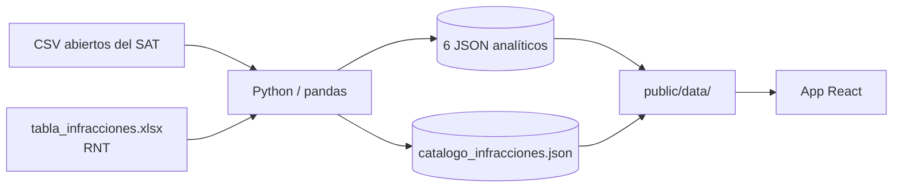
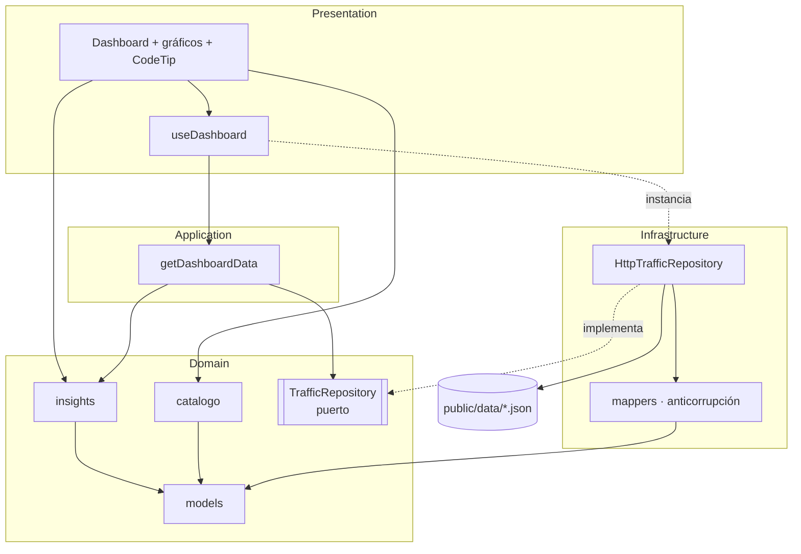

# Radiografía de papeletas · Lima Metropolitana

MVP analítico *end-to-end* que audita el impacto financiero y conductual de las infracciones de tránsito en Lima Metropolitana, a partir de datos abiertos del **SAT** y del **Reglamento Nacional de Tránsito (RNT)**.

---

## 1. Descripción del proyecto

**Problema.** Los datos abiertos del SAT son tablas planas que casi nadie lee. Esa sobrecarga de información oculta dos cosas con valor para decidir:

1. **Estacionalidad:** cómo las fiestas (Fiestas Patrias y Navidad / Año Nuevo) cambian la severidad de las infracciones.
2. **Fuga fiscal:** en qué tipos de falta se concentran los mayores "agujeros negros" de dinero no cobrado.

**Solución.** Un panel interactivo que aplica *data storytelling*: cada gráfico responde una pregunta y su título es el hallazgo calculado a partir de los datos, no una etiqueta genérica. Además expone la reincidencia por tipo de falta y permite consultar, en cada código, la ficha oficial de la infracción (sanción, monto, puntos, medida preventiva).

**Usuarios objetivo:** analistas de gestión tributaria, equipos de fiscalización y periodismo de datos.

> La **fuga estimada** es una métrica analítica derivada del procesamiento, no un dato contable oficial.

---

## 2. Procesamiento previo de la información (CSV → Python → JSON)

El frontend **no procesa datos crudos**. Un pipeline en Python transforma los CSV abiertos del SAT en 6 archivos JSON pequeños y listos para graficar, más un catálogo de infracciones.



### Etapas del procesamiento

| # | Etapa | Qué ocurre |
|---|---|---|
| 1 | **Ingesta** | Lectura de los CSV del SAT y de la tabla de infracciones del RNT. |
| 2 | **Limpieza** | Normalización de códigos de falta, fechas y montos; tratamiento de nulos y duplicados. |
| 3 | **Enriquecimiento** | Cruce de cada papeleta con el RNT para asignar severidad oficial (Leve / Grave / Muy Grave), monto base y puntos. |
| 4 | **Agregación** | Cálculo de métricas por mes, por severidad y por código de falta. |
| 5 | **Métricas derivadas** | Fuga fiscal estimada (monto base SAT frente a lo efectivamente recaudado), reincidencia y KPIs globales. |
| 6 | **Exportación** | Un JSON por historia analítica con `to_json(orient="records", force_ascii=False)`. |

> **Nota:** esta tabla describe las etapas a nivel conceptual. Ajusta los nombres y criterios (por ejemplo, la fórmula exacta de `fuga_estimada`) a lo que realmente hace tu notebook o script.

### Contrato de datos (archivos JSON)

| Archivo | Campos | Gráfico |
|---|---|---|
| `kpis_globales.json` | `total_papeletas`, `recaudacion_total_soles`, `total_puntos_licencia_perdidos`, `brecha_financiera_mef`, `ultimo_trimestre_analizado` | Tarjetas KPI |
| `tendencia_mensual.json` | `Mes infracción`, `papeletas`, `monto_soles`, `Nombre_Mes` | Línea + área |
| `distribucion_severidad.json` | `severidad_oficial`, `cantidad`, `monto_total` | Dona |
| `historias_fuga_fiscal.json` | `código_falta`, `severidad_oficial`, `total_papeletas`, `monto_base_sat`, `fuga_estimada` | Barras relacionales |
| `historias_patron_temporal.json` | `Mes infraccion`, `Leve`, `Grave`, `Muy Grave`, `No Especificado`, `Nombre_Mes` | Área apilada |
| `historias_reincidentes.json` | `código_falta`, `casos_reincidentes`, `monto_reincidencia` | Ranking |
| `catalogo_infracciones.json` | `codigo`, `infraccion`, `calificacion`, `monto_soles`, `monto_con_descuento`, `sancion`, `puntos`, `medida_preventiva`, `responsable_solidario` | Fichas emergentes |

El catálogo se genera con `scripts/xlsx_a_json.py`, que además repara filas con columnas corridas y fusiona sanciones partidas en varias filas del Excel.

---

## 3. Arquitectura del sistema (Clean Architecture & DDD)

El frontend se organiza en cuatro capas. La **regla de dependencia** es que las capas externas conocen a las internas, nunca al revés. El dominio no importa React, `fetch` ni Recharts.

| Capa | Responsabilidad | Ejemplos |
|---|---|---|
| **Domain** | Modelos, reglas de negocio y el *puerto* de datos. Lenguaje ubicuo: papeleta, severidad, fuga, reincidente. | `models.ts`, `insights.ts`, `catalogo.ts`, `TrafficRepository.ts` |
| **Application** | Casos de uso que orquestan el dominio. | `getDashboardData.ts` |
| **Infrastructure** | Adaptadores: cómo se obtienen los datos y se traducen al dominio. | `HttpTrafficRepository.ts`, `mappers.ts` |
| **Presentation** | UI, hooks y tema visual. | `Dashboard.tsx`, gráficos, `CodeTip.tsx`, `palette.ts` |

**Conceptos DDD aplicados**

- **Puerto y adaptador:** `TrafficRepository` (dominio) define el contrato; `HttpTrafficRepository` (infraestructura) lo implementa. Cambiar a una API REST o a otro origen no toca el dominio ni la UI.
- **Capa anticorrupción:** `mappers.ts` normaliza las llaves de Python (`Mes infracción`, `código_falta`, `Muy Grave`, el typo `total_paleletas`) al modelo limpio del dominio.
- **Servicio de dominio:** `buildInsights` calcula los hallazgos (concentración de la fuga, mes pico, alza de gravedad en fiestas, concentración de reincidencia).
- **Degradación elegante:** si falta el catálogo, el panel sigue funcionando sin fichas.

### Mapa visual de dependencias



> **Nota de diseño:** la raíz de composición (donde se instancia `HttpTrafficRepository`) está hoy en `useDashboard.ts`. Si el proyecto crece, conviene moverla a `main.tsx` e inyectarla con un Context para que Presentation no conozca Infrastructure.

### Estructura de carpetas

```
sat-lima-storytelling/
├── public/
│   └── data/                      # 6 JSON analíticos + catálogo
├── scripts/
│   └── xlsx_a_json.py             # Excel RNT -> catalogo_infracciones.json
├── src/
│   ├── domain/
│   │   ├── models.ts              # entidades y tipos
│   │   ├── TrafficRepository.ts   # puerto
│   │   ├── insights.ts            # reglas narrativas
│   │   ├── catalogo.ts            # búsqueda y normalización de códigos
│   │   └── formatters.ts          # S/, miles, %
│   ├── application/
│   │   └── getDashboardData.ts    # caso de uso
│   ├── infrastructure/
│   │   ├── HttpTrafficRepository.ts
│   │   └── mappers.ts
│   ├── presentation/
│   │   ├── components/            # Hero, Dashboard, ChartCard, gráficos, CodeTip
│   │   ├── hooks/useDashboard.ts
│   │   └── theme/                 # palette.ts, global.css
│   ├── App.tsx
│   └── main.tsx
├── index.html
├── vite.config.ts
└── tsconfig.json
```

---

## 4. Stack tecnológico

| Área | Tecnología | Motivo |
|---|---|---|
| UI | **React 19** | Componentes declarativos y hooks. |
| Lenguaje | **TypeScript** (modo estricto) | El modelo de dominio queda tipado de punta a punta. |
| Build | **Vite 6** | Arranque rápido y *build* simple. |
| Gráficos | **Recharts** | Gráficos declarativos sobre SVG, integrados con React. |
| Estilos | **CSS con variables** | Tema centralizado, sin dependencias extra. |
| Tipografía | Bricolage Grotesque + IBM Plex Sans | Títulos con carácter y texto numérico legible (cifras tabulares). |
| Procesamiento | **Python + pandas** | Limpieza, cruce con el RNT y agregaciones. |

**Cómo ejecutar**

```bash
npm install
npm run dev      # desarrollo
npm run build    # verificación de tipos + build de producción
```

Los JSON incluidos en `public/data/` (salvo el catálogo) son **datos sintéticos de muestra**. Reemplázalos por los generados por tu pipeline.

---

## 5. Decisiones de storytelling

1. **El título es el hallazgo.** "Tres códigos concentran el 59.5% de la fuga fiscal" informa más que "Fuga fiscal por código". Los titulares se calculan en `insights.ts`, así que cambian solos cuando cambian los datos.
2. **Arco narrativo de lo macro a lo específico.** Titular y KPIs (impacto global) → tendencia (cuándo) → severidad (qué tan grave) → fuga fiscal (dónde se pierde el dinero) → estacionalidad (por qué cambia) → reincidencia (quién repite).
3. **Un solo protagonista.** La brecha financiera MEF es la única tarjeta KPI en amarillo y su cifra encabeza el hero. El ojo va primero al dinero perdido.
4. **Color con significado, no decoración.** Azul asfalto como base institucional y amarillo de marca vial como acento. Semáforo de severidad consistente en todo el panel: verde azulado = Leve, ámbar = Grave, rojo = Muy Grave. El rojo también marca la fuga y la reincidencia, porque en ambos casos algo falló.
5. **Gráfico según la pregunta.**
   - Línea y área para el tiempo.
   - Dona para la composición (pocas categorías).
   - Barras emparejadas para comparar lo esperado con lo perdido.
   - Área apilada para ver cómo cambia la mezcla de severidades mes a mes.
   - Ranking para ordenar a los reincidentes.
6. **Contexto en el momento justo.** Los códigos (`G-52`, `M-01`) no significan nada para un lector general. En lugar de saturar el panel, la ficha emergente revela la infracción, la sanción y los puntos solo cuando el usuario la pide.
7. **Fiestas marcadas en la serie.** Julio y diciembre llevan una línea punteada "Fiestas", de modo que la comparación estacional se ve sin leer números.
8. **Honestidad analítica.** El pie de página aclara que la fuga es una estimación. Si el dato no puede calcularse, el título pasa a una versión neutra en lugar de afirmar algo sin sustento.
9. **Accesibilidad como parte del diseño.** Las fichas funcionan con teclado y táctil, hay foco visible, el color nunca es el único canal (cada categoría también lleva etiqueta) y se respeta `prefers-reduced-motion`.

---

## Fuentes

- Datos abiertos del Servicio de Administración Tributaria de Lima (SAT).
- Reglamento Nacional de Tránsito y su tabla de infracciones y sanciones.
